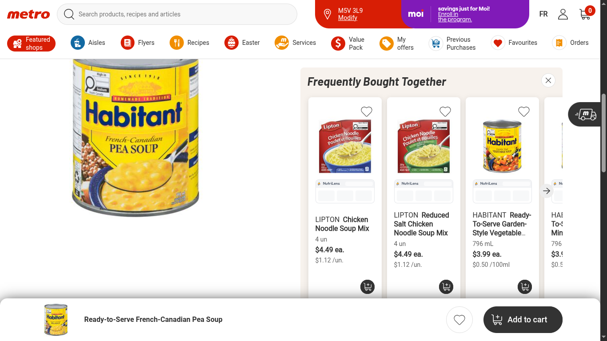
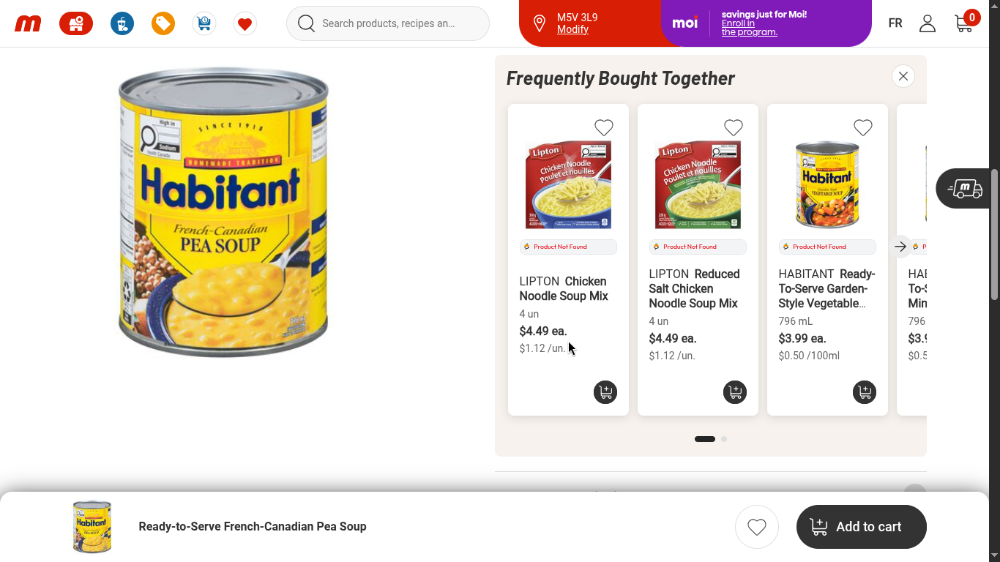
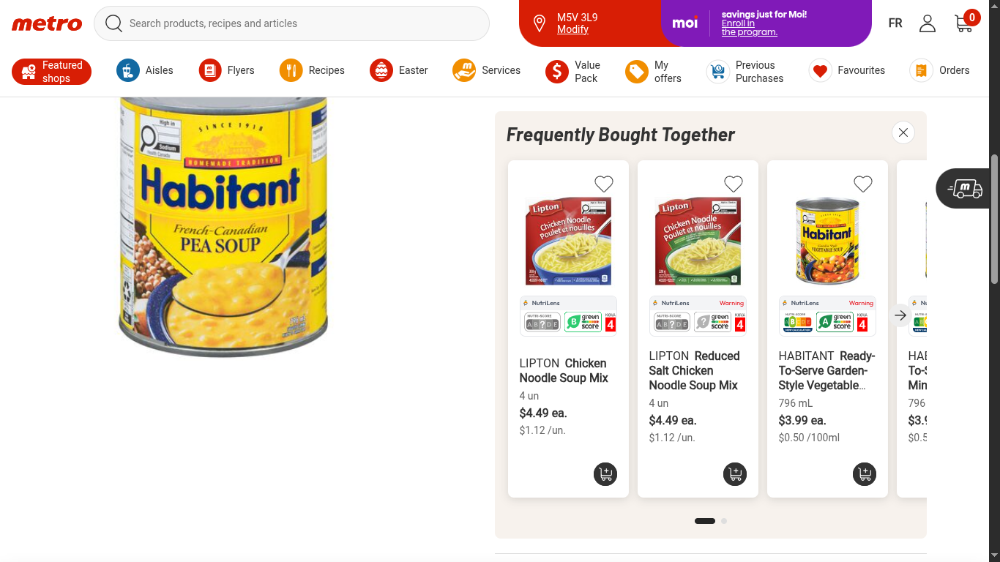
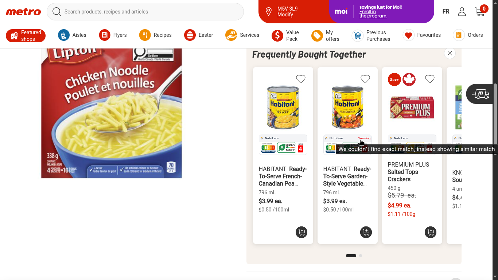
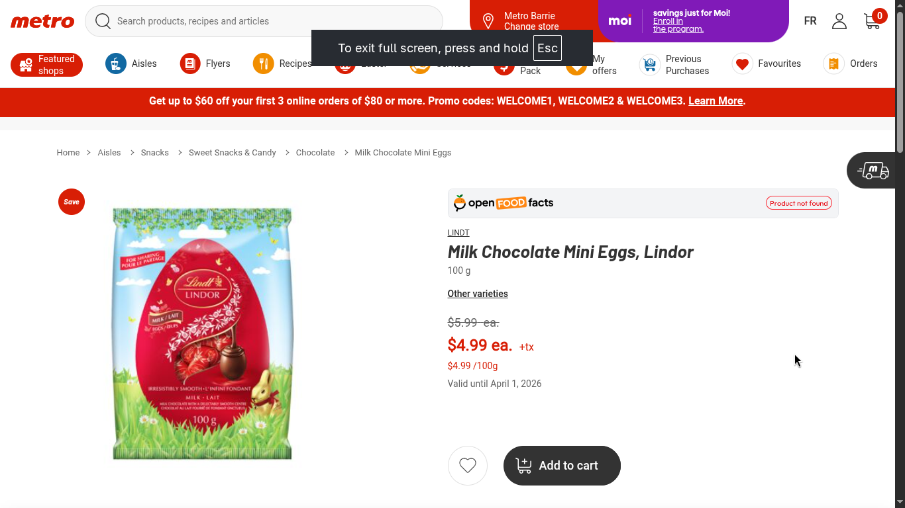
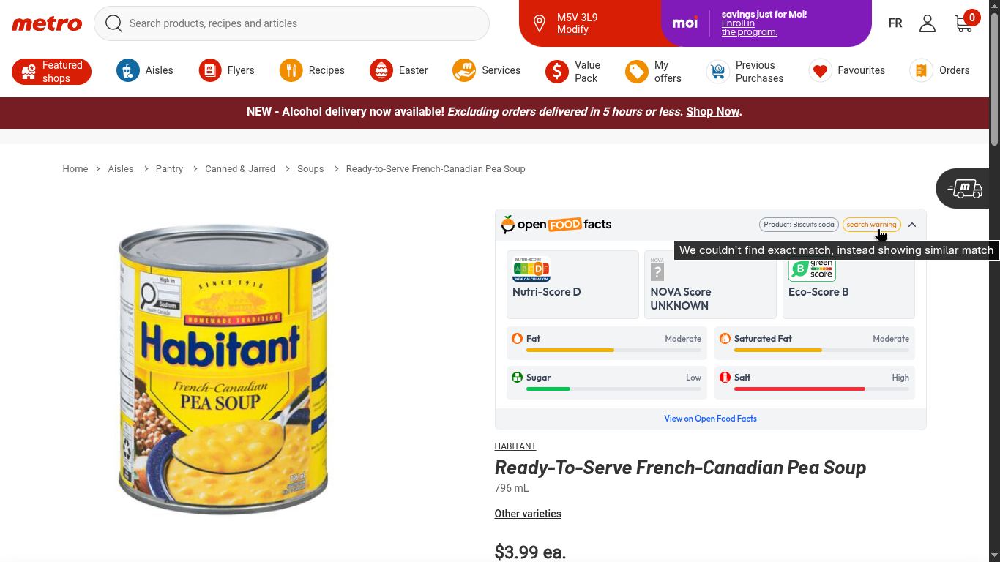
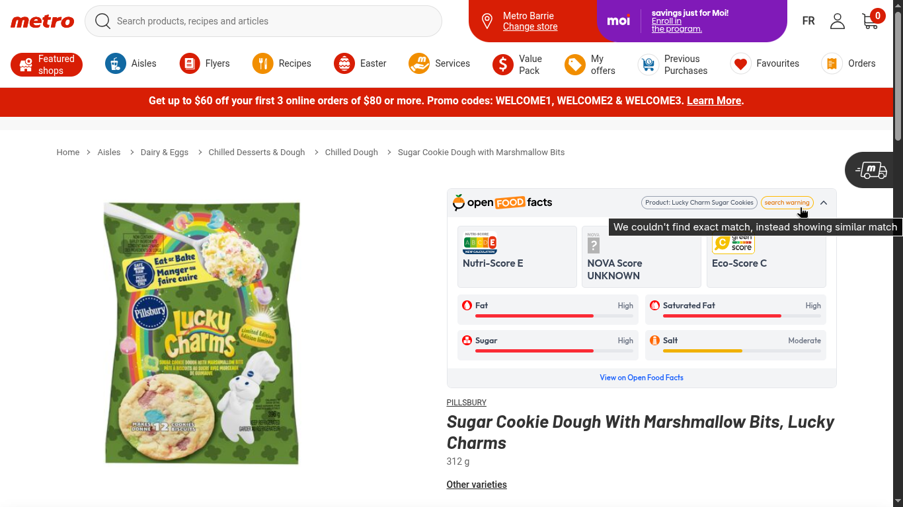
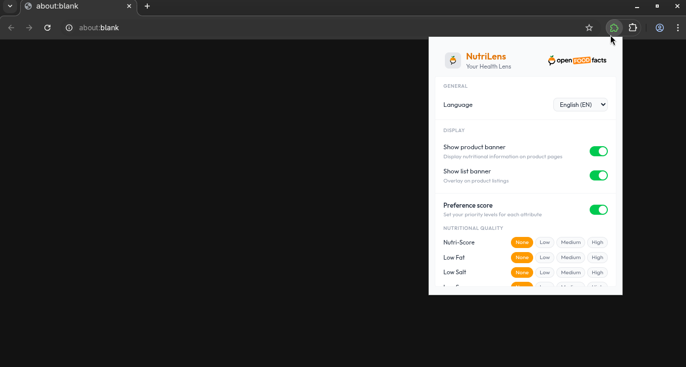
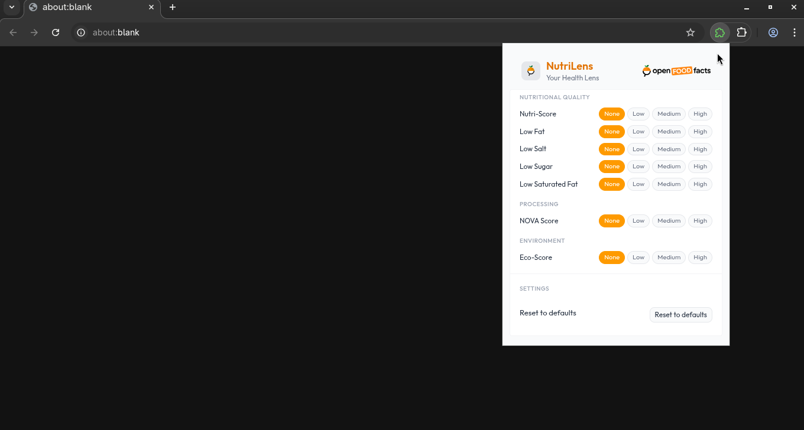

# NutriLens

> **Google Summer of Code 2026** - Open Food Facts Project #P5 Prototype  
> A browser extension that brings Open Food Facts data directly to your grocery shopping experience.

---

## Overview

**NutriLens** is a browser extension that overlays nutritional information from [Open Food Facts](https://world.openfoodfacts.org/) onto e-commerce grocery websites. It helps users make informed purchasing decisions by displaying:

- **Nutri-Score** ratings (nutritional quality)
- **NOVA classification** (food processing levels)
- **Eco-Score** (environmental impact)
- **Personalized preference matching** (coming soon)

Currently supports **metro.ca** and **walmart.ca** with an extensible adapter system for adding more retailers.

---

## NutriLens V2

### Demo Video
<video src="https://github.com/user-attachments/assets/7ad6ec70-93c8-4b30-a790-5b849be32cd4" controls></video>

### Product View

### Product List View

### Popup View

## NutriLens V1

### Demo Video
<video src="https://github.com/user-attachments/assets/e5682225-0012-478c-bfcb-2ab23899a765" controls></video>

### List Banner Loading

### List Banner Not Found

### List Banner Results

### List Banner Search Warning

### Product Banner Not Found

### Product Banner Search Warning 1

### Product Banner Search Warning 2

### Popup Window UI 1

### Popup Window UI 2

## NutriLens V0

### Demo Video
<video src="https://github.com/user-attachments/assets/1a849b7c-144e-4396-98fe-7c887590a4be" controls></video>

---

## Features

### Product Details View
- Latest Nutri-Score, NOVA, and Eco-Score display
- Nutrient-level visual bars (fat, salt, sugar, saturated fat)
- Product search confidence, preference score, and more details
- Link to Open Food Facts product page

### Product List View Badges
- Compact clickable badges on product grid/list views
- Quick visual indicators for nutritional quality and preference scores

### Multi-Language Support
- English (EN)
- French (FR)
- Easily extensible i18n system

### Settings Panel
- Language selection
- Feature toggles
- Preference management

### Smart Data Handling
- Caching for performance
- Graceful handling of missing products
- Real-time settings sync across tabs
- Intersection Observer for lazy loading
- Mutation Observer for DOM changes
- and many more...

