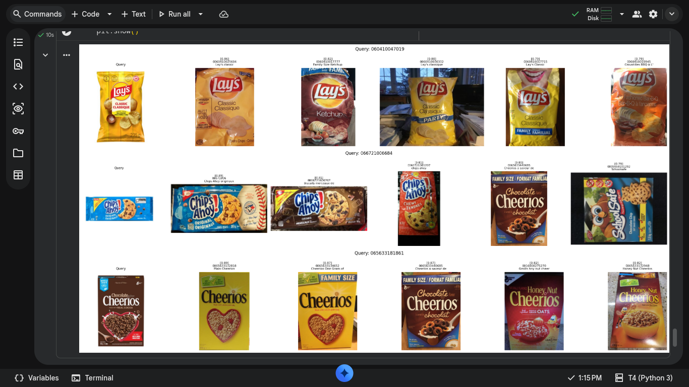
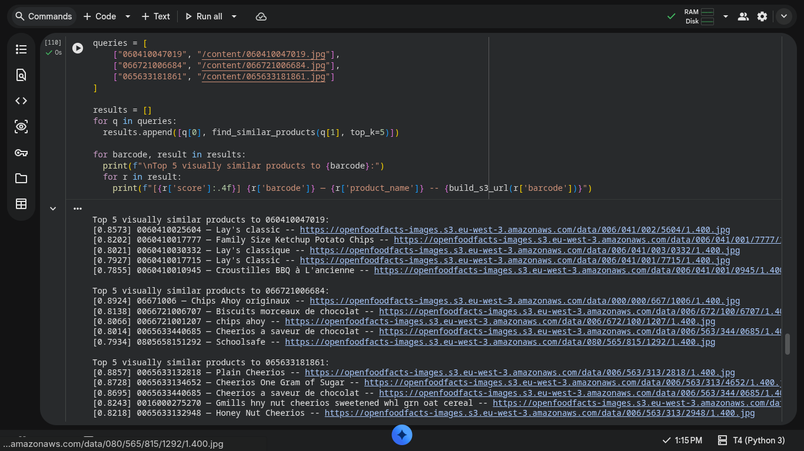

# Colab Notebooks

1. [FTS vs Fuzzy OFF DB](https://colab.research.google.com/drive/1XRTl4adTmOJQMk68uIGsdtmF_KAxcozH?usp=sharing) - Experiment comparing FTS vs Fuzzy matching on OFF database
2. [Semantic Search with Sentence Transformers](https://colab.research.google.com/drive/1YWbDePzX8NoD0KA4ZuWutmNpiZCv34s9?usp=sharing) - Experiment using Sentence Transformers for semantic search
3. [Semantic Search with CLIP](https://colab.research.google.com/drive/1cq9oAlOjm-gUC3Z_LSKMCfVdl2zNF2v7?usp=sharing) - Experiment using CLIP for semantic search

# Demo

## Semantic Search with CLIP

