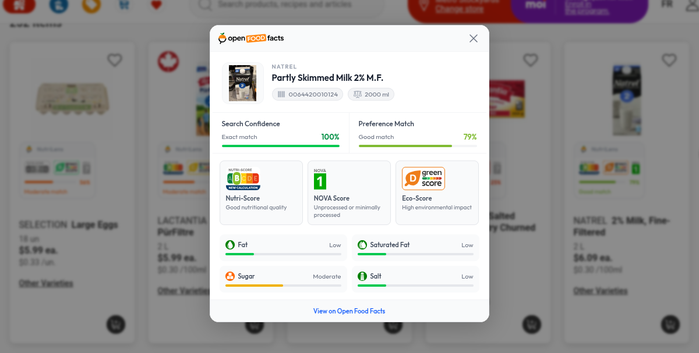
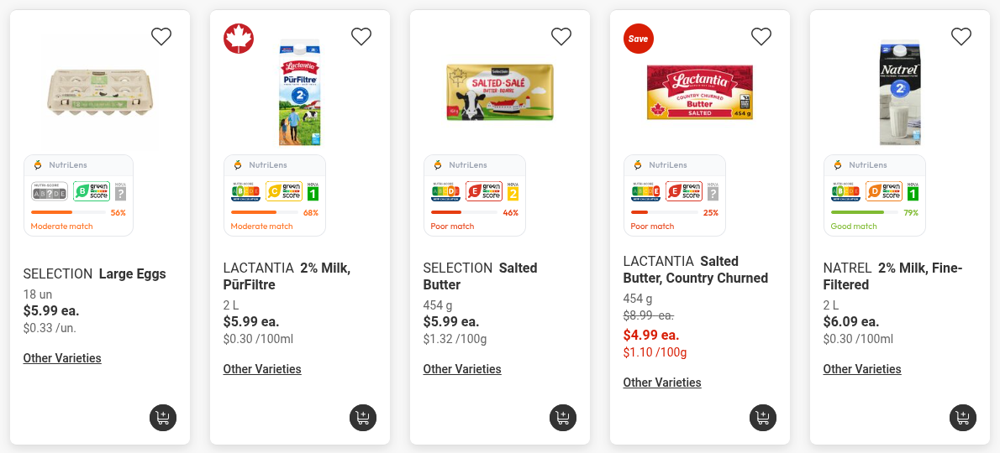
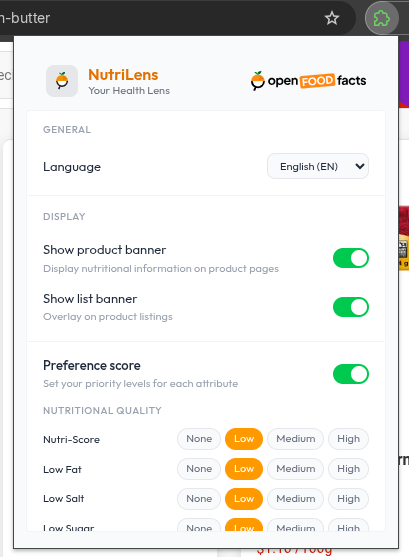

# OFF P5 Prototype - GSoC 2026

A collection of prototypes for Open Food Facts Project #5 (Online Grocery Extension) - Google Summer of Code 2026.

## Repositories

- **[NutriLens](./NutriLens/)** - Browser extension that overlays Open Food Facts nutritional data (Nutri-Score, NOVA, Eco-Score) onto grocery websites. Currently supports metro.ca with an extensible adapter system.

- **[DuckDB Server](./duckdb-server/)** - Flask API with DuckDB backend for managing product-store mappings, lookups, and store information.

- **[Preference Score Calculator](./preference-score-calculator/)** - Web app that calculates preference scores for food products based on nutritional quality, processing level, and environmental impact.

- **[Request Interceptor](./request-interceptor/)** - WXT-based browser extension that intercepts and logs API calls from websites to understand how grocery sites fetch product data.

- **[Colab Python Experiments](./colab-python-experiments/)** - Python experiments for FTS vs fuzzy search and vector search on Open Food Facts database.

# Demo Videos

## NutriLens V2 Demo
<video src="https://github.com/user-attachments/assets/7ad6ec70-93c8-4b30-a790-5b849be32cd4" controls></video>

## DuckDB Server Demo
<video src="https://github.com/user-attachments/assets/e0662c45-0f8e-44bc-bb03-dc0d466a7e36" controls></video>

## Preference Score Demo
<video src="https://github.com/user-attachments/assets/84b05a82-c926-465a-a642-7ffba04fedf3" controls></video>

## Request Interceptor Demo
<video src="https://github.com/user-attachments/assets/8e81ef2c-4c6a-4565-8ad1-ce1299074566" controls></video>

## Additional Screenshots

## NutriLens V2

### Product View

### Product List View

### Popup View

### Semantic Search with CLIP

